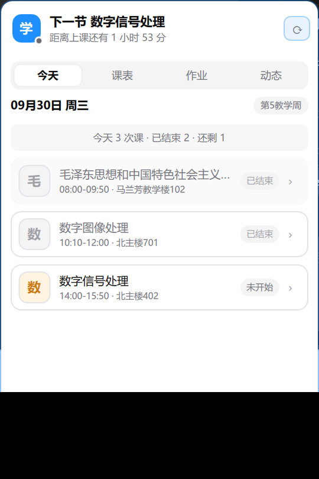
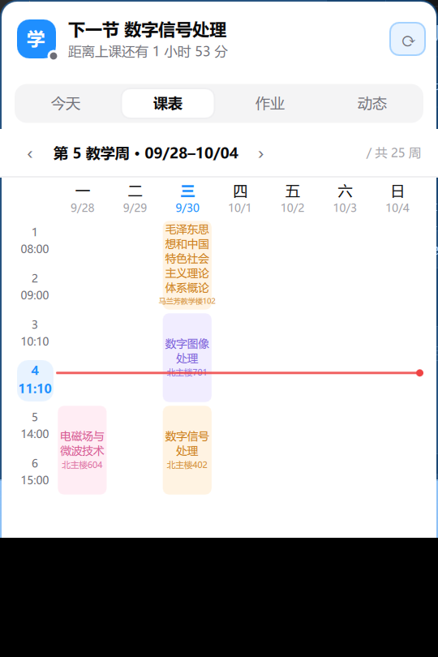
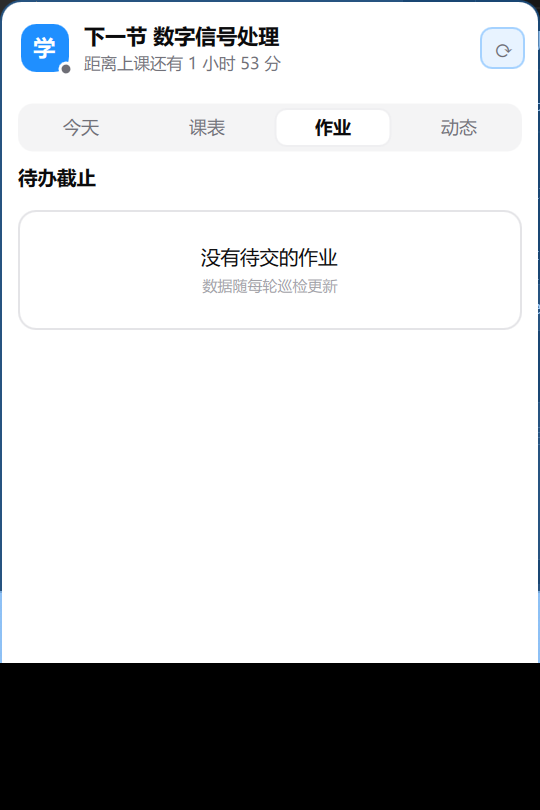
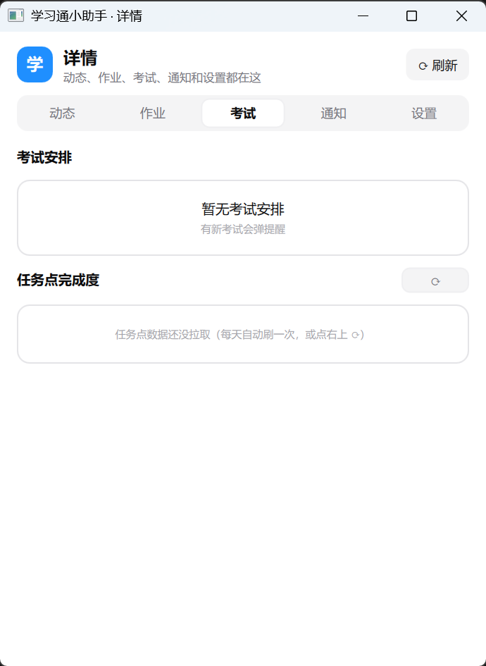
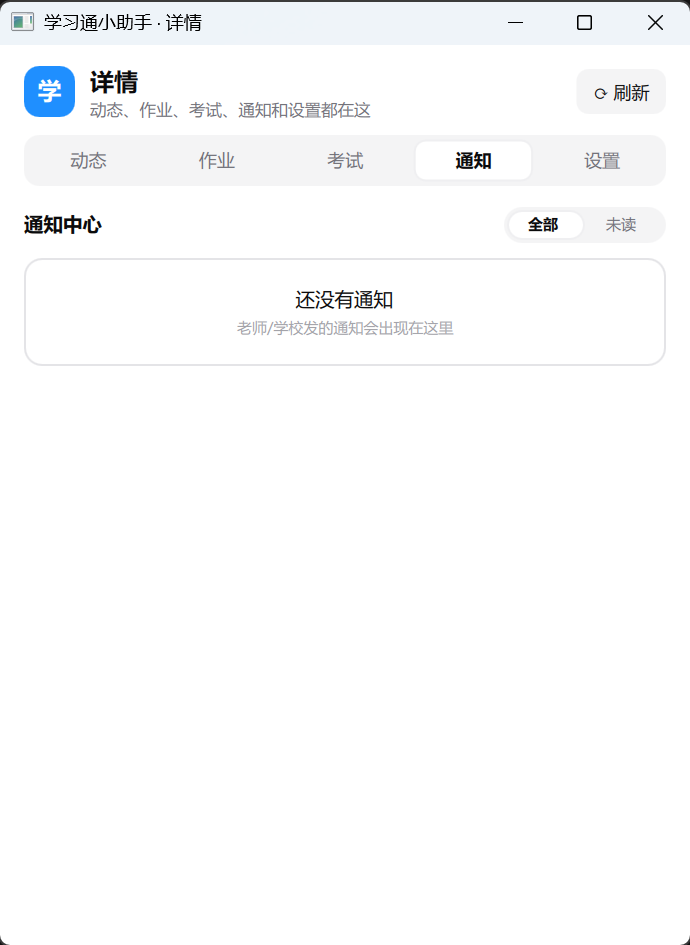

# Xuexitong-mcp

> 原名 `chaoxing-mcp`，2026-09 起更名为 `Xuexitong-mcp`（GitHub 旧地址自动重定向，包名同步改为 `xuexitong_mcp`）。

学习通（超星）MCP Server + 桌面小助手 —— 把你的课表（含 .ics 日历导出）、作业截止、考试、章节进度、通知、云盘接进任意 MCP 客户端（ZCode / Claude Desktop / Cursor 等），或在桌面上挂一个常驻的"学习通小助手"悬浮窗。

全部接口均经真实账号实测验证（2026-09）。

## 工具列表（16 个）

| 工具 | 功能 | 关键参数 |
|---|---|---|
| `login` | 登录并持久化会话 | `phone?`, `password?` |
| `get_profile` | 个人资料（姓名/学校/uid/fid/学年学期） | 无 |
| `get_schedule` | 课表；传 `week` 看某一周（含真实日期），不传看全学期汇总 | `week?` |
| `export_schedule_ics` | 全学期课表导出 .ics 日历（学校真实节次时间，含课前 30 分钟提醒） | `save_dir`, `filename?` |
| `list_courses` | 我学的全部课程（含 courseid/clazzid/cpi） | 无 |
| `list_materials` | 课程资料区文件列表，支持文件夹逐层下钻 | `course`，`folder_data_id?`，`folder_enc?` |
| `find_materials` | 资料区按关键词递归搜索（免一层层翻文件夹） | `course`, `keyword`, `max_depth?` |
| `download_material` | 下载资料文件到本地 | `course`, `data_id`, `save_dir`, `filename?` |
| `list_homework` | 课程作业列表（序号/名称/提交状态/完成进度） | `course` |
| `get_homework_detail` | 单份作业详情（题量/满分/作答起止时间/得分） | `course`, `index` |
| `get_homework_deadlines` | 全课程未交作业截止看板（未来→已过期排序；逐份查详情，稍慢） | `course?`, `horizon_days?` |
| `list_exams` | 全校考试安排（时间/时长/状态/分数） | 无 |
| `list_chapters` | 课程章节树 + 任务点完成进度 | `course` |
| `get_progress_overview` | 全课程任务点进度一览（未完成多的在前；逐课查询，稍慢） | 无 |
| `list_notices` | 通知中心（支持关键词过滤/未读过滤，正文摘要 160 字） | `unread_only?`, `limit?`, `keyword?` |
| `list_pan_files` | 个人云盘文件列表，支持文件夹下钻 | `folder_id?` |

### 用法示例

```text
用户: 我第 3 周有哪些课？星期几上课？
 → get_schedule(week=3)        # 每个安排带真实日期（如 09-16 周三）

用户: 把这学期课表导进手机日历
 → export_schedule_ics(save_dir="D:\\课件")   # 得到 .ics，导入日历 App 即可

用户: 最近有什么要交的作业？哪个最急？
 → get_homework_deadlines()    # 按截止时间排序，已过期的单独标出

用户: 哪门课还有任务点没刷完？
 → get_progress_overview()     # 未完成多的排前面

用户: 数字电路这门课还有什么作业没交？
 → list_homework(course="数字电路")

用户: 数字电路作业 1 的截止时间是多久？得了多少分？
 → get_homework_detail(course="数字电路", index=1)

用户: 找一下实验报告模板在资料区哪个位置
 → find_materials(course="数字电路", keyword="报告")

用户: 搜一下通知里提到"考试"的
 → list_notices(keyword="考试")

用户: 把老师传的课件下载到 D:\课件
 → list_materials(course="数字电路") → download_material(course="数字电路", data_id=..., save_dir="D:\\课件")
```

## 安装

```bash
git clone https://github.com/DanMo661/Xuexitong-mcp.git
cd Xuexitong-mcp
pip install -r requirements.txt   # requests / pycryptodome / mcp / PySide6 / windows-toasts / pywin32
```

Python >= 3.10。也可以安装为命令（可选）：

```bash
pip install .        # 之后得到 Xuexitong-mcp 命令，等价于 python -m xuexitong_mcp
```

## 凭据配置（三选一，优先级从高到低）

1. **调用 `login` 工具时传入** `phone` / `password` 参数
2. **环境变量** `CHAOXING_PHONE` / `CHAOXING_PASSWORD`（推荐服务器场景，凭据不落盘）
3. **`config.json`**（与代码同目录）：

```bash
copy config.example.json config.json   # Linux: cp
# 编辑 config.json 填入 phone / password
```

## MCP 客户端配置

三种写法任选其一：

```jsonc
// 1. 源码直接运行（clone 后免安装）
{ "command": "python", "args": ["D:/path/to/Xuexitong-mcp/xuexitong_server.py"] }

// 2. 模块方式运行
{ "command": "python", "args": ["-m", "xuexitong_mcp"], "cwd": "D:/path/to/Xuexitong-mcp" }

// 3. pip install . 之后用命令名
{ "command": "Xuexitong-mcp" }
```

外层按客户端惯例包一层：ZCode 写在 `~/.zcode/cli/config.json` 的 `mcp.servers` 下，Claude Desktop 写在 `claude_desktop_config.json` 的 `mcpServers` 下。Windows 下 `command` 建议写 python 绝对路径（如 `D:/Python/python.exe`）。

## 学习通小助手（桌面常驻助手 v3.0）

不想开对话、也不想再点开学习通 App？`assistant/` 是完整的桌面常驻助手：**巡检引擎 + Windows 通知 + PySide6/QML 悬浮窗 + 托盘**，学习通有新作业/资料/通知/出分时主动送达，你只需要看一眼桌面。

```bash
# 首次：建虚拟环境装依赖（一条命令装齐，别手挑）
python -m venv .venv
.venv\Scripts\pip install -r requirements.txt
# 日常：双击 学习通小助手.bat，或
.venv\Scripts\pythonw -m assistant.app
```

### 它替你盯着什么

- **每日自动巡检**（默认 30 分钟一轮，可调）：扫活跃课程的作业列表（含状态变化）、资料区（递归两层）、通知中心、考试安排表；对学习通只读查询、课间 0.8s 节流，做一个温和的人类
- **新增内容分级**：文件名/标题含 作业·HW·实验·报告·考试 → 高优（Toast 弹窗）；老师发的一般通知 → 中优；普通课件更新 → 低优只进时间线
- **出分提醒**：作业从「待批阅」变「已完成」时弹 Toast 并附上「得分 X / 满分 Y」（自动拉详情页取分）；疑似被打回（已交→未交）也会提示
- **考试看板**：新考试安排高优提醒；Today 页横幅倒计时（进行中变红色报结束时间）；考试页按 进行中→未考→已结束 排序，已结束带分数
- **任务点完成度**：每门课还差几个任务点没刷（每天自动刷一次，可手动 ⟳）；网课这类不在课表里的课单独分组不漏掉；Today 概览条直接给缺口总数
- **DDL 渐进提醒**：截止前 3 天首次提及 → 1 天前提醒 → 4 小时前升级 → 1 小时前紧急，同一作业每个阶段只提醒一次；已完成/待批阅/手动忽略的作业永不打扰
- **通知中心**：老师/学校通知落盘成列表（未读红点、点开看全文、本地已读）；巡检发现新通知按发件人分级弹
- **人性化规则**：默认免打扰 23:00–07:30；正在上课时自动静默（下课补弹）；红色只留给紧急事项
- **通知通道**：Windows 原生 Toast（进通知中心，**可点击直接跳到对应页面**；windows-toasts 优先、winotify 回退）+ 应用内时间线 + 可选邮件备份通道（SMTP 授权码，默认关）

### 悬浮窗（cc-switch 浅色设计语言）

- **迷你态**（360×64）：品牌块 + 三态状态点（上课中蓝呼吸 / 30 分钟内要上课橙 / 平时灰）+ 当前/下一节课与倒计时；点顶栏展开收起；**Alt+Shift+C 全局热键**随时唤起/隐藏；拖拽贴边磁吸
- **展开卡**（360×540，四标签页）：
  - **今天**：课程手风琴（进行中/同时段/已结束三态，点行展开老师·节次·周次）、DDL 横幅、考试横幅、任务点缺口摘要
  - **课表**：周网格（时间轨当前节胶囊 + **当前时间红线**、连堂合并满铺色块、周次导航翻周）
  - **作业**：DDL 看板（紧迫度变色、过期沉底）；**右键作业卡 → 在学习通打开 / 不再提醒**（自动复制作业名）
  - **动态**：巡检事件时间线（出分带分数、考试带时间）
- **详情窗**（托盘/右键进入，五标签页）：动态 / 作业（悬停出「去交 ↗」「✕ 忽略」按钮，底部恢复入口）/ 考试+任务点 / 通知中心（全部·未读过滤）/ 设置（巡检间隔、免打扰、Toast、开机自启、**导出课表 .ics 到手机日历**、邮件）
- **托盘常驻**：双击显隐小窗；右键菜单承载全部入口；单实例锁防双开；位置自动记忆
- **开机自启**：设置页一键开关（HKCU Run 注册表直指 pythonw 无黑框，可在任务管理器启动页管理）







### 无 GUI 模式（服务器/调试）

```bash
.venv\Scripts\python -m assistant.watch --once          # 单轮巡检
.venv\Scripts\python -m assistant.watch --interval 30   # 常驻轮询
.venv\Scripts\python -m assistant.app --screenshot out.png   # UI 自截图
```

- 旧版 tkinter 悬浮窗仍保留（`python -m xuexitong_mcp.widget`），新功能一律进 `assistant/`
- 运行期状态文件 `settings.json`（含 SMTP 授权码）、`store.json`（巡检基线）、`widget_geometry.json` 均已 gitignore，绝不入库；模板见 `settings.example.json`
- 可选 PyInstaller 打包（`pyinstaller --onedir --windowed assistant/app.py`，排除 QtWebEngine 后约 128MB）：数据目录取 exe 所在目录（或设 `XXT_HOME` 环境变量重定向），把 `config.json` 放 exe 旁即可独立运行；打包形态下首次登录态适配仍在迭代，自用推荐 venv + bat 方式

## 旧版 tkinter 悬浮窗（v1，兼容保留）

```bash
python -m xuexitong_mcp.widget       # 或 pip install . 后运行 xuexitong-assistant
```

- **收起态**：状态点 + 日期/周次/星期 + 下一节课（倒计时）/ 正在上课（带进度条）+ 待交作业数 + 明天首课，卡片约 336px 宽
- **点击右下角"详情 ▼"展开**（或双击卡片）：今日课程逐节（当前课程带强调条与进度）、待交作业倒计时（2 天内变琥珀、已过期变红）、最新 3 条通知（未读蓝色 + 头部未读徽标）
- **交互**：全卡可拖动（屏幕坐标锚定，跟手不漂移）、`↻` 手动刷新、右键菜单任意处可用（刷新/展开收起/置顶/浅色深色切换/退出）；位置与主题自动记忆
- **细节**：临近上课或有过期作业时状态点红黄呼吸闪烁；展开/收起高度过渡动画；防闪烁；时刻文案每 20 秒自动刷新
- **对账号友好**：课表秒出；作业截止需全课程逐课扫描（约 1 分钟，期间显示"扫描中"），自动刷新默认 30 分钟一次，全部只读查询
- 凭据与 MCP 共用同一套 `config.json` / 环境变量，登录状态互通

## 会话与安全设计

- `config.json`（凭据）与 `session_cookies.json`（登录态）均在 `.gitignore` 中排除，**绝不入库**。
- cookie 持久化跨进程复用，失效自动重登；登录态探测结果缓存 5 分钟，减少每工具一次的探测请求。
- 网络层带指数退避重试（429/502/503/504）；下载走流式写盘，大文件不占内存；服务器文件名经安全化处理（防路径穿越）。

## 注意事项

- **风控**：学习通对高频请求有风控。本工具不主动加请求间隔（由 MCP 客户端调用频率天然决定），请不要用它做批量爬取、定时轮询间隔过短等操作。账号是自己的，封了别哭。
- **只读声明**：所有工具均为 GET/查询语义，不提交任何表单。自动签到/刷课/答题类需求请绕行。
- **cookie 失效**：会自动重登；若密码改了记得更新 config.json。
- **课程匹配**：`course` 参数为课名模糊关键词（如 "数字电路"），多门课命中时取第一个匹配，建议先 `list_courses` 确认课名。

## 技术原理（逆向备忘）

<details>
<summary>点开查看各接口协议细节</summary>

### 功能地图

登录后 `GET https://i.chaoxing.com/base`，左侧菜单每个功能的 `dataurl` 属性即入口：

| 菜单 | dataurl 域 |
|---|---|
| 课表 | kb.chaoxing.com |
| 互动 | mooc2-ans.chaoxing.com/visit/interaction |
| 通知 | notice.chaoxing.com/pc/notice/myNotice |
| 消息 | im.chaoxing.com/webim/me |
| 云盘 | pan-yz.cldisk.com/pcuserpan/index |
| 考试列表 | mooc1-api.chaoxing.com/exam/.../examlist |
| 通讯录 | contactsyd.chaoxing.com |

### 登录

`POST https://passport2.chaoxing.com/fanyalogin`，uname/password 均为 AES-128-CBC 加密（key=iv=`u2oh6Vu^HWe4_AES`，PKCS7 填充，base64 输出）。成功响应 `{"status": true}`。手机端域名 `passport2-app.chaoxing.com` 已 NXDOMAIN。

### 课表

`POST https://kb.chaoxing.com/pc/curriculum/getMyLessons` → `data.lessonArray`（课名=name、教室=location、老师=teacherName、节次=beginNumber+length、星期=dayOfWeek）。

两个关键坑（均实测验证）：

- **不带参数只返回"当前周"的课**——每条的 `weeks` 就是当前周数（如 "3"），不是全学期！要查别的周必须带 form 参数 `{"week": N}`（`currentWeek`/`queryWeek`/`weekNum` 均无效）。全学期视图 = 逐周 `week=1..maxWeek` 拉取后按 (lessonId, 星期, 节次, 教室, 老师) 聚合，周数压缩回 "1-16" 串。
- **dayOfWeek 是 1 基**（1=周一 … 7=周日）。`data.curriculum.firstWeekDate`（毫秒时间戳，第 1 周周一 00:00 北京时间）+ `dayOfWeek-1` 天即为某周某课的真实日期；该字段与 `lessonTimeConfigArray`（学校真实节次表，`"8:00-8:50"` 形式）是 .ics 导出时间的直接来源，无需本地猜测。

### 课程列表

`GET mooc2-ans.chaoxing.com/mooc2-ans/visit/courselistdata?courseType=1&courseFid=<fid>`；课名在链接**后方**的 `course-name` span 的 title 里。fid 从 base 页 JS 变量提取。

### 资料与下载

- 列表：`GET mooc2-ans.chaoxing.com/mooc2-ans/coursedata/stu-datalist?courseid&clazzid&cpi&ut=s`；文件夹下钻加 `&dataId=<id>&enc=<onclick 里的 enc>`。
- 下载：`GET mooc1.chaoxing.com/coursedata/downloadData?dataId&classId&cpi&courseId&ut=s`（四件套缺一不可）→ 302 → `d0.cldisk.com` 直链，**必须带 `Referer: https://pan-yz.chaoxing.com/`** 否则 403。CDN 的 filename* 是裸 UTF-8 字节（非标），需 latin-1→utf-8 修复。

### 作业（enc 已解）

课程中间页 `GET mooc1.chaoxing.com/visit/stucoursemiddle?courseid&clazzid&cpi&ismooc2=1&v=2` 服务端渲染了一组隐藏 `<input>`：

```html
<input type="hidden" id="enc"     value="..."/>  <!-- 页面通用 enc -->
<input type="hidden" id="openc"   value="..."/>
<input type="hidden" id="oldenc"  value="..."/>
<input type="hidden" id="workEnc" value="..."/>  <!-- 作业 tab 专用 -->
<input type="hidden" id="examEnc" value="..."/>  <!-- 课程考试 tab 专用 -->
```

作业列表 `GET mooc1.chaoxing.com/mooc2/work/list?courseId&classId&cpi&ut=s&openc&enc=<workEnc>&t=<毫秒时间戳>&stuenc=<页面enc>&isdisplaytable=2`，**enc 必须用 workEnc 而非页面 enc**，且需要 t 和 stuenc 伴随参数，否则"无权限"。作业条目在 `<li onclick="goTask(this);" data="...">` 里，data 属性即详情页直链（带独立 enc）。

作业详情 `GET <data 属性直链>`（形如 `mooc1.chaoxing.com/mooc-ans/mooc2/work/task?courseId&classId&cpi&workId&answerId&enc=...`），服务端渲染含题量/满分/作答起止时间（"作答时间: MM-DD HH:MM 至 MM-DD HH:MM"，后者即截止时间）/得分（"智能分析 NN 分"）。

### 考试列表

`GET https://mooc1-api.chaoxing.com/exam-ans/exam/test/examcode/examlist`（dataurl 里不带 exam-ans 的旧路径会 302 到这里）。服务端直接渲染 `<tr class="dataTr">` 表格：编号/名称/时间/时长/考试状态/作答状态/分数/方式。

### 章节与任务点

`GET mooc2-ans.chaoxing.com/mooc2-ans/mycourse/studentcourse?courseid&clazzid&cpi&enc=<页面enc>&openc&fromMiddle=1&ut=s`。服务端渲染章节树：

- 总进度：`已完成任务点: <span>N</span>/M`
- 一级章：`catalog_num` 序号 + `catalog_name` 的 `span title`
- 二级节：`chapter_item` + `catalog_sbar` 编号；状态在 `catalog_task`：`icon_yiwanc`=已完成、`catalog_points_yi` 数字=N 个待完成、无标记=未开放

### 通知中心

`POST https://notice.chaoxing.com/pc/notice/getNoticeList`，form 参数 type/notice_type/lastValue/sort 等，游标翻页用返回的 `notices.lastGetId`。条目字段：title/content/createrName/completeTime/isread。

- 列表里的 `content` 字段**就是全文**（含换行与链接），无需再请求详情页。
- form 里的 `kw` 参数**实测无效**（传了照旧全量返回），关键词搜索只能在客户端对 title+content 过滤，搜索范围即翻页拉到的最近约 100 条。

### 云盘

`GET https://pan-yz.cldisk.com/pcuserpan/index` 页面里的 JS 常量：`const encstr`、`const rootdir`、`const currentPuid`。列表 API：`GET pan-yz.cldisk.com/opt/listres?puid&shareid=0&parentId=<rootdir或文件夹id>&page=1&size=100&enc=<encstr>`（带 Referer）。返回 `list[]`（isfile/name/filesize/id）与 `totalCount`。encstr 含时间戳签名，每次会话需重新从 index 页提取。

### 个人资料

base 页：姓名（`aria-label="账号：X"`）、学校（`#siteName` title）、uid/fid（JS 变量）。学号接口 `contactsyd.chaoxing.com/pc/user/getUserInfo` 已停用（"接口已停用"）。

</details>

## 已知限制

- **成绩单页**：`stat2-ans.chaoxing.com/study-data/index` 对程序化访问返回 403（页面 enc/oldenc、Referer 组合均被 WAF 拒绝），暂无法查询课程成绩统计。替代：作业得分见 `get_homework_detail`，考试分数见 `list_exams`。
- **学号**：个人资料接口已停用，`get_profile` 不含学号。
- **课程公告**：无独立接口，已并入 `list_notices`（教师通知标题通常带课程名）。
- **消息（IM）**：`im.chaoxing.com/webim/me` 是 WebSocket 应用，程序化访问返回错误页，未支持。
- **错题集**：`/mooc2-ans/wrongque/page` 页面为 JS 动态加载题目，数据接口藏在压缩 JS 中，未解析。
- **课程讨论区**：`groupweb.chaoxing.com/course/topic/topicList` 需要的请求参数无法从课程页稳定拼出，未支持。
- **云盘文件下载**：官方前端明示"文件夹/超过 500MB 需客户端下载"，且下载加密串由服务端 JS 生成，仅有列表查询。
- **作业详情解析**：不同题型（选择题/报告类）详情页结构有差异，`get_homework_detail` 对取不到的字段留空而非报错。
- **截止看板**：作业截止时间只在详情页上，`get_homework_deadlines` 需对每份未交作业单独请求详情；详情页缺失截止信息时标"截止未知"。作答时间无年份，按"与今天最接近的年份"补全（跨年作业才可能排错序）。
- **通知搜索**：服务端 kw 参数无效，关键词过滤在客户端进行，范围仅最近约 100 条。
- **课程匹配**：`course` 参数按课名子串匹配（精确同名优先，否则取第一个命中）。同名课程多时建议先 `list_courses` 用完整课名。
- 非学历教育/继续教育等特殊账号体系未验证。

## 项目结构

```
xuexitong_mcp/
├── client.py    # 接口层：会话 / 登录 / 重试 / 页面解析（返回结构化数据）
├── server.py    # MCP 工具层：结构化数据 → 可读文本
├── widget.py    # 桌面悬浮窗（可选，tkinter 标准库，零新增依赖）
└── __main__.py  # python -m xuexitong_mcp 入口
xuexitong_server.py  # 兼容旧配置的直接运行入口
学习通小助手.bat    # Windows 双击启动桌面小助手（pythonw，无控制台）
tests/run_tests.py  # 纯逻辑单测（零依赖：python tests/run_tests.py，也兼容 pytest）
pyproject.toml      # pip install . 打包配置（Xuexitong-mcp / xuexitong-assistant 两个命令）
```

## License

MIT (c) Wu Jiale
